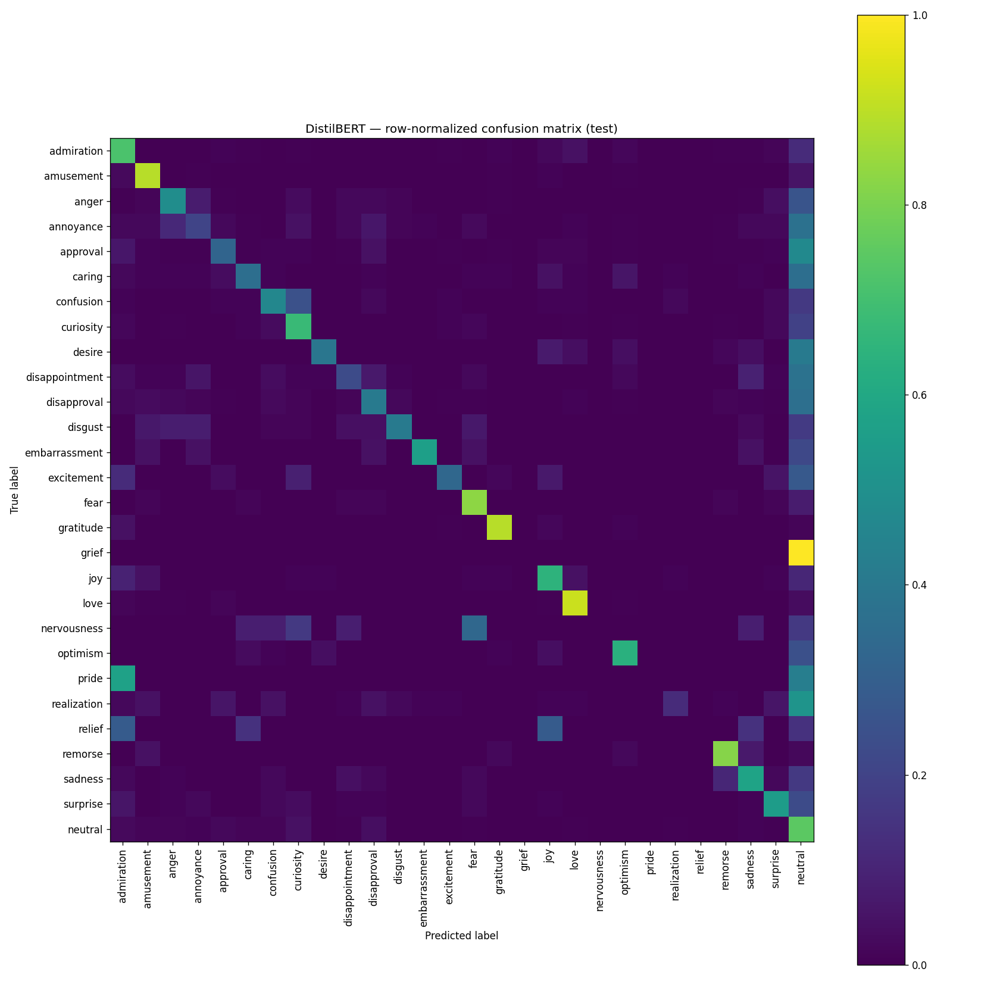

# 💬 GoEmotions Classifier

Classifying the emotion in Reddit comments across **28 categories** (27 emotions + neutral), comparing a classic **TF-IDF + logistic regression** baseline with a fine-tuned **DistilBERT** transformer, and digging into *why* the model makes the mistakes it does.

---

## Results

Evaluated on the official GoEmotions **test set**, using single-label comments only.

| Model | Macro-F1 | Accuracy |
|---|---|---|
| TF-IDF + logistic regression (baseline) | **0.421** | 0.502 |
| DistilBERT (fine-tuned) | **0.475** | 0.630 |

DistilBERT beats the baseline overall, but **not on every emotion**. See [rare emotions](#rare-emotions-the-baseline-wins) below.

**Why macro-F1?** GoEmotions is very imbalanced: *neutral* makes up a large share of the data, while emotions like *grief* and *relief* have only a handful of examples. Plain accuracy would reward a model that mostly predicts common classes. Macro-F1 scores each emotion separately and averages them, so rare emotions count just as much as common ones.

Full per-emotion scores: [`results/per_class_f1.csv`](results/per_class_f1.csv)

### Rare emotions: the baseline wins

| Emotion | Test examples | TF-IDF + LR F1 | DistilBERT F1 |
|---|---|---|---|
| relief | 7 | 0.133 | **0.000** |
| pride | 7 | 0.364 | **0.000** |
| grief | 2 | 0.000 | 0.000 |

DistilBERT never correctly predicted *relief*, *pride*, or *grief*, while the simpler baseline got some *relief* and *pride* comments right. The likely reason: I trained the baseline with `class_weight='balanced'`, which makes mistakes on rare emotions cost more, but trained DistilBERT with a standard, unweighted loss. With so few examples, DistilBERT learned it could mostly ignore these classes. Adding a class-weighted loss to DistilBERT is the first thing I'd try next.

(With only 2–7 test examples each, these scores are noisy, but a score of 0 across all three is still a clear signal.)

**Takeaway:** this doesn't mean the baseline is the better model. DistilBERT wins clearly overall (0.475 vs. 0.421 macro-F1, 0.630 vs. 0.502 accuracy).

The comparison on rare emotions also wasn't quite fair. The two models were trained under different rules:

- The **baseline** used `class_weight='balanced'`. A mistake on a rare emotion like *relief* counted far more than a mistake on *neutral*, so the model was pushed to take rare emotions seriously.
- **DistilBERT** used a standard, unweighted loss. Every mistake counted the same, and since rare emotions barely show up in the training data, the model could ignore them almost entirely while still scoring well overall.

So the gap on rare emotions mostly reflects a difference in *training setup*, not a weakness of transformers. Giving DistilBERT the same class weighting would make it a fair comparison, and is the most likely fix. The baseline's real value here was showing exactly where DistilBERT needs work.

### Confusion matrix (DistilBERT, row-normalized)

Each row shows where the comments with that *true* emotion ended up. A strong diagonal means correct predictions; color off the diagonal shows which emotions get confused.

---

## Error analysis: reading 30 mistakes

Scores tell you *how often* a model is wrong, but not *why*. I manually reviewed 30 random test-set mistakes from DistilBERT and categorized each one:

| Category | Meaning | Count |
|---|---|---|
| `label_wrong` | The model's answer was better than the dataset label | 14 |
| `model_wrong` | The label was right and the model missed it | 8 |
| `both_wrong` | Neither the label nor the model matched the emotion I'd assign | 5 |
| `ambiguous` | Both answers were reasonable | 3 |

**About two-thirds of the "mistakes" (19 of 30) involved label problems**, which suggests the model's true performance is better than its test score shows.

My annotated review: [`results/mistakes_30.csv`](results/mistakes_30.csv)

### Patterns I found

**1. The model reacts to surface words, not meaning.**
> "No no. totally justified": labeled *approval*, predicted **disapproval**

The model latched onto "No no" instead of the meaning of the full sentence.

**2. Mild approval and disapproval collapse into neutral.**
> "I'll join your cause brother!": labeled *approval*, predicted **neutral**
>
> "Well first, I'm against government period, and second I'm conveying this under a layer of satire…": labeled *disapproval*, predicted **neutral**

When approval or disapproval is expressed through ideas instead of emotional words ("agree," "great," "hate"), the model falls back to neutral. Across the whole test set, **47%** of approval comments and **36%** of disapproval comments were predicted as neutral.

**3. There's a strong pull toward neutral.**
> "I'm replying just bask in the glow with someone else! Yay!!": labeled *approval*, predicted **neutral** (I'd call this *excitement*)

Even an explicit "Yay!!" was predicted as neutral, likely because neutral dominates the training data.

**4. Realization labels are inconsistent.**
> "I'm going Saints and Chiefs. Although I think the Chiefs-Pats game could go either way": labeled *realization*
>
> "I've found that carrying 21 chromosomes is the sweet spot": labeled *realization* (reads as a joke)

Nothing is being realized in either comment. If the training labels for *realization* are this inconsistent, the model can't learn a clear pattern, which likely explains why it also predicts realization in odd places:

> "I totally thought the same thing! I was like, oh honey nooooo!": labeled *neutral*, predicted **realization** (I'd call this *disapproval*)

**5. Rare and specific emotions get overlooked.**
> "I never knew cringing could be so… cathartic.": labeled *embarrassment*, predicted **fear**

The label isn't exactly wrong, but **relief** is the more specific emotion here, and neither the annotators nor the model picked it. Relief is one of the rarest classes in the dataset (only **7** test examples), and DistilBERT scored an F1 of 0 on it, so this isn't a one-off.

---

## How I built it

1. **Loaded GoEmotions** (simplified version) from Hugging Face and kept only comments with exactly one label, so each comment has a single answer.
2. **Inspected the class balance** to confirm how imbalanced the data is before choosing a metric.
3. **Built a baseline:** TF-IDF features (unigrams + bigrams) with logistic regression, using `class_weight='balanced'` so rare emotions aren't ignored. I tuned the regularization strength `C` on the validation set (best: **C = 8**).
4. **Fine-tuned DistilBERT** for 3 epochs, keeping the checkpoint with the best **validation macro-F1** (not the lowest loss, since macro-F1 is the metric I actually care about).
5. **Evaluated both models once on the test set**, reporting per-emotion F1 and macro-F1.
6. **Analyzed errors** with a row-normalized confusion matrix and a manual review of 30 mistakes.

### Key decisions

| Decision | Why |
|---|---|
| Macro-F1 instead of accuracy | The data is heavily imbalanced; accuracy hides poor performance on rare emotions |
| Single-label comments only | Keeps it a standard one-answer classification problem as a first step |
| Baseline before transformer | Gives a reference point for whether DistilBERT is worth the extra cost |
| Tuning on validation, not test | Keeps the test score an honest estimate of real-world performance |
| Row-normalized confusion matrix | With raw counts, the matrix is dominated by *neutral*; normalizing keeps rare classes visible |
| `max_length=64` tokens | Reddit comments are short, so this keeps nearly everything while training much faster |

---

## Next steps

- **Multi-label classification:** use all comments and let the model predict several emotions at once, which better fits real comments.
- **Class-weighted loss for DistilBERT:** the baseline's balanced class weights helped it on rare emotions where DistilBERT scored 0, so applying the same idea to DistilBERT is the most promising fix.
- **Clean or relabel suspicious examples**, especially *realization*, and measure how much scores change.
- **Try a larger model** (e.g., RoBERTa or DeBERTa) and compare the gain against the baseline.

---
